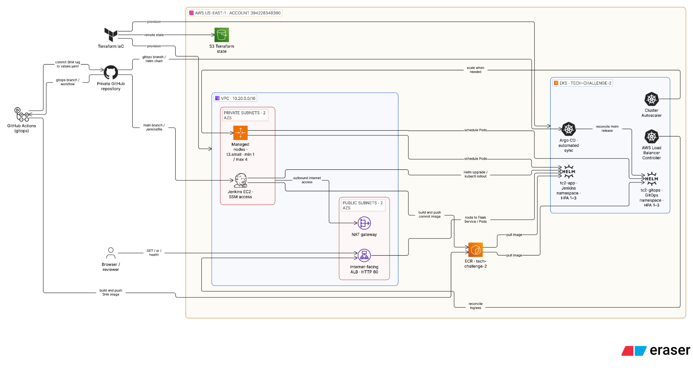

# Tech Challenge 2

A Flask “Hello, World!” application packaged with Docker and deployed to Amazon EKS. Terraform defines the AWS network, EKS cluster, ECR repository, Jenkins instance, and IAM roles. The `main` branch uses Jenkins to build an image, push it to ECR, and deploy the Helm chart. The separate `gitops` branch uses GitHub Actions for image publishing and Argo CD for deployment.

## Verified deployment

- **Jenkins deployment:** [Open the application](http://k8s-techchal-tc2app-22d999e667-844764659.us-east-1.elb.amazonaws.com/) · [Health check](http://k8s-techchal-tc2app-22d999e667-844764659.us-east-1.elb.amazonaws.com/health). The root URL returned HTTP 200 in the latest supplied check.
- **GitOps deployment:** `tc2-gitops` is an internal ClusterIP service in namespace `tech-challenge-2-gitops`; its Argo CD Application was verified `Synced` and `Healthy`. It intentionally has no public Ingress.
- **Region/account:** `us-east-1` / `394228349360`. The ALB hostname can change if the Ingress is recreated; retrieve the current address with `kubectl get ingress tc2-app -n tech-challenge-2`.

The two deployments use the same ECR repository and Helm chart, but separate Kubernetes namespaces and release names. The [architecture diagram](docs/architecture.svg) shows the infrastructure and both delivery paths; the [Eraser source](docs/architecture.eraser) remains editable.



## Repository map

| Path | Purpose |
| --- | --- |
| `app.py`, `requirements.txt`, `Dockerfile` | Flask app, `/health` endpoint, and nonroot Gunicorn image on port 8000 |
| `terraform/bootstrap/` | Versioned, encrypted S3 bucket for Terraform state |
| `terraform/infrastructure/` | VPC, private worker nodes, EKS, ECR, controller IAM roles, Jenkins EC2 instance |
| `helm/flask-app/` | Deployment, ClusterIP Service, HPA, and optional ALB Ingress |
| `helm/aws-load-balancer-controller-values.yaml` | Values used when installing the AWS Load Balancer Controller |
| `Jenkinsfile` | Jenkins build, ECR push, Helm deployment, and rollout check |
| `docs/architecture.svg`, `docs/architecture.png` | Exported architecture diagram (scalable and raster formats) |
| `docs/architecture.eraser` | Editable Eraser diagram source |
| `gitops` branch | `.github/workflows/gitops.yml` and `argocd/application.yaml` |

## Architecture and scaling

The EKS box in the diagram is a logical cluster view. The application pods run on the managed worker nodes in the VPC private subnets. Each HPA's 1–3 range applies to its entire deployment, not to each node.

Terraform creates a VPC spanning `us-east-1a` and `us-east-1b`, with public and private subnets and one NAT gateway. The managed EKS node group runs `t3.small` Amazon Linux 2023 instances in the private subnets. It has **minimum 1, desired 1, maximum 4** nodes. The Cluster Autoscaler can adjust the node group when pods cannot be scheduled or nodes become unnecessary. The cluster also has the VPC CNI, CoreDNS, kube-proxy, pod identity agent, and metrics-server add-ons.

The Flask HPA targets **50% CPU and 50% memory utilization**, with **1–3 total application replicas** per release. Kubernetes scales replicas based on either metric; Cluster Autoscaler separately adds nodes when pending pods require capacity. The chart currently has no hard placement rule guaranteeing exactly one application pod on every node. The GitOps deployment shares the same worker node group, so the two HPAs can affect total cluster demand.

The AWS Load Balancer Controller watches the Jenkins release's Ingress and provisions an internet-facing ALB. Its `/health` path checks targets. The GitOps Application overrides `ingress.enabled=false`, which avoids provisioning a second public ALB. The public endpoint uses HTTP on port 80; TLS and a custom domain are outside this challenge configuration.

## Prerequisites and setup

Use an AWS principal authorized to manage the resources in account `394228349360`. Install AWS CLI, Terraform `>=1.10,<2.0`, Docker, `kubectl`, and Helm 3. Configure AWS CLI for `us-east-1`; check the account before applying anything:

```bash
aws sts get-caller-identity --query '{Account:Account,Arn:Arn}' --output json
aws configure get region
```

This repository pins the infrastructure AWS provider to `6.66.0` and checks the account ID. Terraform state is stored in `s3://tc2-tfstate-394228349360-us-east-1`, under separate `bootstrap/` and `infrastructure/` keys. The S3 bucket has public access blocked, versioning, and server-side encryption. Keep the `.terraform.lock.hcl` files in Git; never commit `.tfstate`, `.tfvars`, plans, or credentials.

For a **first-time bootstrap only**, initialize the bootstrap directory without its not-yet-created S3 backend, apply, and then migrate local state to the new backend. Back up the local state until the migration has been verified:

```bash
cd terraform/bootstrap
terraform init -backend=false
terraform plan
terraform apply
terraform init -migrate-state
terraform state list
cd ../..
```

For an already bootstrapped environment, simply run `terraform init` in the relevant directory. The EKS public API allows only the IPv4 `/32` passed as `admin_cidr`. CloudShell outbound IP can change between sessions; determine the current IP before planning from CloudShell:

```bash
export TF_VAR_admin_cidr="$(curl -4 -fsS --max-time 15 https://checkip.amazonaws.com | tr -d '\n')/32"
cd terraform/infrastructure
terraform init
terraform plan -var="admin_cidr=$TF_VAR_admin_cidr"
# Review the plan before applying changes.
terraform apply -var="admin_cidr=$TF_VAR_admin_cidr"
cd ../..
aws eks update-kubeconfig --region us-east-1 --name tech-challenge-2
kubectl get nodes
```

Updating the endpoint CIDR through the AWS CLI is an operational recovery option, but it creates Terraform drift until `admin_cidr` is updated and applied. CloudShell home storage is small: if provider installation runs out of room, set `TF_DATA_DIR` to an available temporary directory for that session and rerun `terraform init`; keep the tracked lock file and S3 state backend.

Terraform creates the IAM roles for the AWS Load Balancer Controller and Cluster Autoscaler. Install their Helm releases in `kube-system` with their service accounts annotated with the corresponding Terraform role outputs. For the ALB controller, `helm/aws-load-balancer-controller-values.yaml` contains the cluster, region, VPC, and service-account values. Configure the Cluster Autoscaler for cluster `tech-challenge-2` and managed node group autodiscovery. Verify both controllers before deploying the app:

```bash
cd terraform/infrastructure
terraform output vpc_id
terraform output load_balancer_controller_role_arn
terraform output cluster_autoscaler_role_arn
cd ../..
helm repo add eks https://aws.github.io/eks-charts
helm repo add autoscaler https://kubernetes.github.io/autoscaler
helm repo update
```

On a fresh installation, first update the ALB controller values file with the actual VPC ID and IAM role ARN, then install `eks/aws-load-balancer-controller` in `kube-system` using `-f helm/aws-load-balancer-controller-values.yaml`. Install `autoscaler/cluster-autoscaler` in the same namespace with `autoDiscovery.clusterName=tech-challenge-2`, `awsRegion=us-east-1`, and the `cluster_autoscaler_role_arn` service-account annotation. Pin a chart and autoscaler image version appropriate for the running Kubernetes minor version. The current cluster's Helm releases can be inspected with `helm status` to reproduce their precise values.

```bash
helm list -n kube-system
kubectl get deployment -n kube-system aws-load-balancer-controller cluster-autoscaler
kubectl get nodes
```

These Helm installations are operational steps; Terraform defines their AWS-side IAM roles, not the controller Helm releases themselves.

## Deploy with Jenkins (`main`)

Terraform creates a private `t3.medium` Jenkins EC2 instance with an encrypted 30 GB root volume, an instance profile, and Systems Manager access. It has no public IP or inbound security-group rule. `jenkins-user-data.sh` installs Java 21, Docker, Git, AWS CLI, and Jenkins, then starts the services. Access the Jenkins UI through an authorized Systems Manager session/port forwarding to instance port 8080; retrieve the instance ID with `terraform output jenkins_instance_id` in `terraform/infrastructure`.

The repository's instance role definition initially attaches **only** `AmazonSSMManagedInstanceCore`. A functioning Jenkins build additionally needs permission to push to the designated ECR repository, call `eks:DescribeCluster`, and authenticate/authorize to deploy into EKS. Configure that IAM and EKS access explicitly for the Jenkins instance role (`tech-challenge-2-jenkins`), scoped to this project where possible. Jenkins also needs working `docker`, `helm`, and `kubectl` commands, access to the Docker daemon, and a Git credential that can read this private repository. The user-data script does **not** install Helm or kubectl or add the `jenkins` user to the Docker group; prepare and verify those before expecting a fresh instance to run this pipeline. Do not place personal access tokens in the repository or build logs.

Create a Jenkins Pipeline job pointing at the private repository's `main` branch and `Jenkinsfile`, then run **Build Now**. The committed job definition has no webhook or polling trigger; builds are manually initiated unless you configure one separately. The pipeline:

1. Sets an image tag from the first 12 characters of the checked-out Git commit.
2. Lints and renders the Helm chart.
3. Builds the Docker image and pushes it to ECR.
4. Updates kubeconfig, upgrades/installs Helm release `tc2-app` in namespace `tech-challenge-2`, waits, and checks Deployment rollout.

The namespace must exist before this Jenkinsfile runs. On a new cluster create it once with `kubectl create namespace tech-challenge-2`. The pipeline passes `image.repository` and `image.tag` to Helm, overriding the sample image tag in `helm/flask-app/values.yaml`.

Verify the release and the public endpoint:

```bash
helm status tc2-app -n tech-challenge-2
kubectl get deployment,pods,hpa,service,ingress -n tech-challenge-2
ALB_HOST=$(kubectl get ingress tc2-app -n tech-challenge-2 -o jsonpath='{.status.loadBalancer.ingress[0].hostname}')
curl -fsS "http://${ALB_HOST}/health"
curl -fsS "http://${ALB_HOST}/"
```

The expected health response is `{"status":"healthy"}` and the root page contains `Hello, World!`.

## GitOps alternative (`gitops` branch)

The `gitops` branch preserves the infrastructure and chart while adding `.github/workflows/gitops.yml` and `argocd/application.yaml`. It deploys a **second** release to `tech-challenge-2-gitops`; do not replace the Jenkins release with this Application.

1. Configure GitHub's AWS OIDC provider `token.actions.githubusercontent.com` and role `tech-challenge-2-github-actions-ecr`. Its trust condition permits `repo:MontelQ/tech-challenge-2:ref:refs/heads/gitops` with audience `sts.amazonaws.com`. Grant ECR login/push for this repository. The workflow requests `id-token: write` and `contents: write`; GitHub Actions must be allowed to push its image-tag commit back to the `gitops` branch.
2. Install Argo CD in namespace `argocd` using the upstream installation instructions. Give it read-only access to the private repository: add an SSH deploy key in the repository settings, then store its private half as an Argo CD repository Secret. For an existing private-key file in a secure location, one way to register it is:

   ```bash
   kubectl create secret generic tc2-gitops-repo -n argocd \
     --from-literal=type=git \
     --from-literal=url=git@github.com:MontelQ/tech-challenge-2.git \
     --from-file=sshPrivateKey=/secure/path/to/deploy-key
   kubectl label secret tc2-gitops-repo -n argocd \
     argocd.argoproj.io/secret-type=repository
   ```

   Keep the private key out of Git and Terraform state. If the Secret already exists, inspect it instead of running the create command again.
3. From the `gitops` branch, apply `argocd/application.yaml`. Automated sync creates namespace `tech-challenge-2-gitops`, installs Helm release `tc2-gitops`, and disables its Ingress.
4. On a push to `gitops` that changes `Dockerfile`, `app.py`, `requirements.txt`, or the workflow file (or a manual `workflow_dispatch`), GitHub Actions assumes the OIDC role, builds and pushes an ECR image tagged with the full commit SHA, then commits that tag to `helm/flask-app/values.yaml`. Argo CD observes the change and syncs the Helm chart. Changes to other paths alone do not start an image build; changing chart files still allows Argo CD to sync them.

Check the two stages independently:

```bash
kubectl get application tc2-gitops -n argocd
kubectl get deployment,pods,hpa,service -n tech-challenge-2-gitops
kubectl get deployment tc2-gitops -n tech-challenge-2-gitops \
  -o jsonpath='{.spec.template.spec.containers[0].image}{"\n"}'
kubectl exec deployment/tc2-gitops -n tech-challenge-2-gitops \
  -c flask-app -- python -c \
  'import urllib.request; print(urllib.request.urlopen("http://127.0.0.1:8000/health", timeout=5).read().decode())'
```

`Synced` and `Healthy` confirm Argo CD's reconciliation, while the ready Deployment, running pod, SHA-tagged image, and successful in-pod health check confirm the workload. GitHub Actions run logs provide evidence for the image build and ECR push.

## Local app check

```bash
python3 -m venv .venv
. .venv/bin/activate
python -m pip install -r requirements.txt
python app.py
# In another terminal: curl -fsS http://127.0.0.1:8000/health
```

The development server in `app.py` binds to loopback; the Docker image runs Gunicorn on `0.0.0.0:8000`:

```bash
docker build -t tc2-local .
docker run --rm -p 8000:8000 tc2-local
```

## Operations, evidence, and teardown

Check `kubectl describe pod` for pending pods; `Too many pods` on a worker node can prompt Cluster Autoscaler to add a node up to the four-node maximum. Check `kubectl get hpa -A` for actual metrics. HPA max 3 is a cap **per Deployment**, not per node, and a node group may remain above minimum while pods or system workloads need capacity. Terraform plan output can include unrelated EKS add-on version refreshes; inspect the full plan rather than applying blindly.

For submission, share the private repository with the mentor and provide the repository URL plus the live ALB URL. Capture Jenkins build success, GitHub Actions success, Argo CD `Synced/Healthy`, healthy pods, HPA, node group settings, and HTTP 200 checks. Verify the ALB address again on submission day. The diagram source can be pasted into an Eraser **Architecture Diagram** and exported alongside the submission.

EKS, EC2, ALB, NAT gateway, and related AWS services incur charges while running. When the challenge no longer needs a live URL, remove Argo/Jenkins Helm releases and Ingress, then destroy dependent Terraform infrastructure and finally the state bucket only after preserving any evidence/state required by the submission. Do not destroy the live deployment before the mentor has reviewed it.
